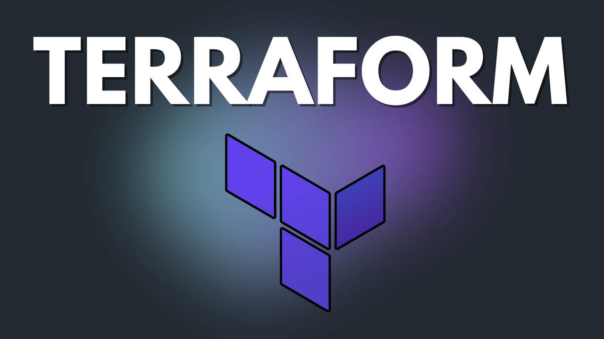
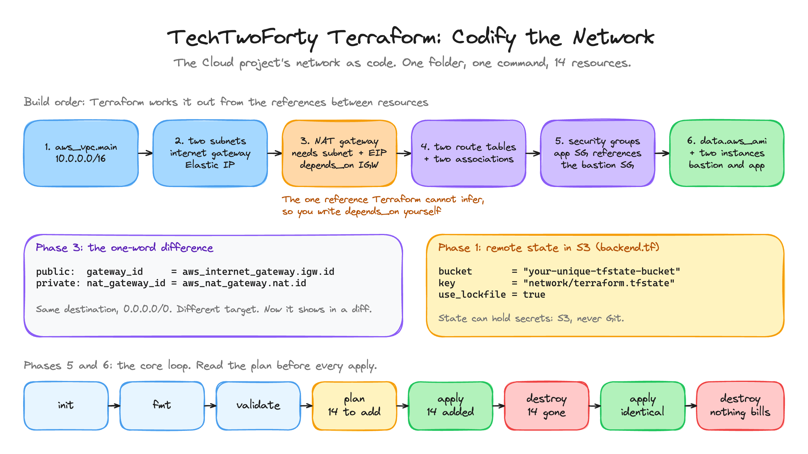

<p align="center">
  
</p>

<h1 align="center">TechTwoForty: Terraform</h1>
<p align="center"><b>Codify the Network</b> · the finished project</p>
<p align="center">
  <a href="https://github.com/wjpearce-github/TechTwoForty-Cloud">← Previous: Cloud</a> ·
  <a href="https://github.com/wjpearce-github/TechTwoForty-Start-Here">Course map</a> ·
  <a href="https://github.com/wjpearce-github/TechTwoForty-Docker">Next: Docker →</a>
</p>

> [!TIP]
> **This repo is the finished template for the Terraform project. Treat it as your cheat sheet.**
> `tf-network/` is exactly what your `~/tf-network` folder should hold at the end: the S3 backend and all 14 resources in `main.tf`. It passes `terraform fmt -check` and `terraform validate` once the two placeholders are filled in.

| | |
|---|---|
| **Section** | 4 of 10 · Infrastructure as code |
| **Time** | About 60 minutes, 6 phases |
| **Runs on** | Terraform on your machine, against your AWS account |
| **Cost** | The same NAT gateway as the Cloud project, while applied. Finish destroyed |
| **Deliverable** | The Cloud project's network as version-controlled Terraform with remote state, destroyed and rebuilt identically |

## The big picture



<sub>Drawn in Excalidraw. To edit it, open <code>assets/diagram.excalidraw</code> at <a href="https://excalidraw.com">excalidraw.com</a>.</sub>

## What is in this repo

```text
TechTwoForty-Terraform/
├── .gitignore            State files and .terraform/ never go in Git
└── tf-network/
    ├── backend.tf        State in S3, with use_lockfile
    ├── main.tf           Provider + 14 resources + the AMI data source
    ├── variables.tf      Empty in this project (you made it with touch)
    └── outputs.tf        Empty in this project (you made it with touch)
```

> [!WARNING]
> Two placeholders in `main.tf` must be replaced before `validate` passes: `YOUR_IP/32` with your address, and `YOUR_KEY_NAME` (twice) with your key pair's name. And in `backend.tf`, `your-unique-tfstate-bucket` with your bucket. Terraform refuses `YOUR_IP/32` outright, which is the safe kind of failure.

## Every resource, and what it was in the console

| Terraform | Console name | Refers to |
|---|---|---|
| `aws_vpc.main` | `course-vpc` | |
| `aws_subnet.public` / `.private` | `course-public` / `course-private` | `aws_vpc.main.id` |
| `aws_internet_gateway.igw` | `course-igw` | `aws_vpc.main.id` |
| `aws_eip.nat` | the Elastic IP | |
| `aws_nat_gateway.nat` | `course-nat` | `aws_eip.nat.id`, `aws_subnet.public.id`, and **`depends_on`** the IGW |
| `aws_route_table.public` | `course-public-rt` | `gateway_id = aws_internet_gateway.igw.id` |
| `aws_route_table.private` | `course-private-rt` | `nat_gateway_id = aws_nat_gateway.nat.id` |
| `aws_route_table_association` × 2 | subnet associations | subnet + route table |
| `aws_security_group.bastion` | `course-public-sg` | `cidr_blocks = ["YOUR_IP/32"]` |
| `aws_security_group.app` | `course-private-sg` | `security_groups = [aws_security_group.bastion.id]` |
| `data.aws_ami.al2023` | the AMI dropdown | latest `al2023-ami-2023*-x86_64` |
| `aws_instance.bastion` / `.app` | `course-bastion` / `course-app` | the AMI, a subnet, a security group |

That is **14 resources**, which is exactly what `plan` should say.

## Cheat sheet, phase by phase

### Phase 1 · Scaffold and remote state

```bash
mkdir tf-network && cd tf-network && touch main.tf variables.tf outputs.tf
aws s3 mb s3://your-unique-tfstate-bucket
code backend.tf
```

Bucket names are global, so pick one nobody else has used. State can contain secrets, which is why it lives in S3 and never in Git.

### Phases 2 to 4 · The resources
Paste the three blocks into `main.tf` in order. The finished file is [`tf-network/main.tf`](tf-network/main.tf).

> [!IMPORTANT]
> `depends_on` on the NAT gateway is the one dependency Terraform cannot work out by itself: the NAT needs the internet gateway, but nothing in its settings mentions it. Every other order comes from the references.

### Phase 5 · The core loop

```bash
terraform init && terraform fmt && terraform validate
terraform plan        # Plan: 14 to add, 0 to change, 0 to destroy.
terraform apply       # type yes. Apply complete! Resources: 14 added.
```

Read the plan before every apply. It is the most important habit in Terraform.

### Phase 6 · Destroy and rebuild

```bash
terraform destroy     # Destroy complete! Resources: 14 destroyed.
terraform apply       # 14 added again, identical
terraform destroy     # leave it destroyed. Nothing bills overnight
```

## Final handover check

- [ ] `main.tf` builds the same network you made by hand in the Cloud project
- [ ] State lives in S3, not on your laptop
- [ ] You read the plan before every apply
- [ ] Everything is destroyed, and the console shows no NAT gateway or Elastic IP

## Common mistakes

| Mistake | What happens | The fix |
|---|---|---|
| Leaving `YOUR_IP/32` or `YOUR_KEY_NAME` in | `validate` or `plan` fails | Replace both, the key name twice |
| Applying without reading the plan | Surprises | Count the 14 first |
| Committing `terraform.tfstate` | Secrets in Git | The `.gitignore` here excludes it |
| Forgetting the final `destroy` | The NAT bills overnight | Finish destroyed |
| Running Terraform outside `~/tf-network` | The Git project cannot find it | Keep it at `~/tf-network` |

## What you can now do

- **Infrastructure as code:** a real network declared in HCL and applied with one command
- **Dependencies:** implicit references, and the one `depends_on` Terraform cannot infer
- **Remote state:** in S3, so it is safe and shareable
- **Repeatability:** destroy and rebuild, identical, on demand

Keep `~/tf-network`. The Git project copies it into `devsecops-capstone/infra/`, and in the Security section a scanner runs against this very file.

---

<p align="center">
  <b>TechTwoForty</b> · Terraform · 4 of 10<br>
  <a href="https://github.com/wjpearce-github/TechTwoForty-Cloud">← Previous: Cloud</a> ·
  <a href="https://github.com/wjpearce-github/TechTwoForty-Start-Here">Course map</a> ·
  <a href="https://github.com/wjpearce-github/TechTwoForty-Docker">Next: Docker →</a>
</p>
